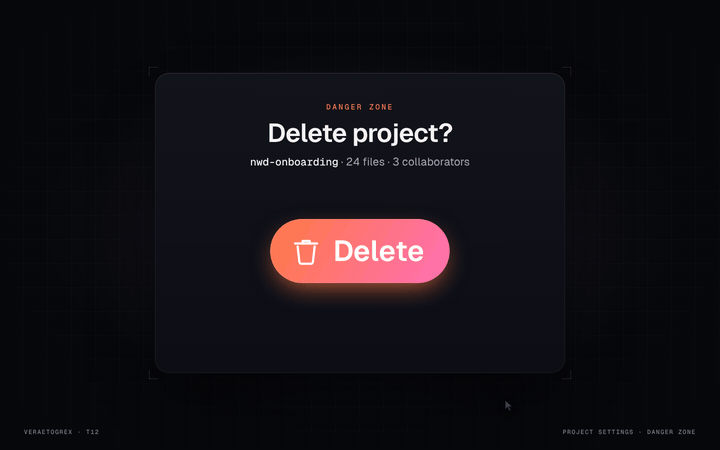

# Bin Delete

**Press Delete. The bin swallows the word.**



**Live demo:** [veraetogrex-portfolio.github.io/bin-delete](https://veraetogrex-portfolio.github.io/bin-delete/) · **Mockup:** [full-screen version](https://veraetogrex-portfolio.github.io/bin-delete/mockup/bin-delete.html)

The lid flips open, the letters of the label hop into the bin one by one, the empty pill folds into a round bin and a ring counts down the undo window. Undo throws the letters back out.

## Use it

Three files, no build step, no dependencies, no web fonts:

```
index.html   markup
style.css    styles and keyframes
script.js    behaviour
```

Download the repo and open `index.html`, or copy the three files into your project.

## Try it

- Press **Delete**, then **Undo** before the ring closes.
- Let the ring close: the component fires `bin:delete` — that's where the real delete goes.

## Make it yours

Listen for the `bin:delete` event on `#danger` to delete for real (the demo page just resets after a beat). The undo window is `data-undo` in ms (default 3000). The label can be any word: the letters are split at runtime.

## What's in `mockup/`

The full 1440×900 screen this component was shot in for the reel:

- `mockup/bin-delete.html` — interactive. `D` plays the demo, `R` resets.
- `mockup/bin-delete.autoplay.html` — the scripted loop the reel was recorded from.
- URL flags: `?frame` puts the screen in a browser window, `?clean` hides the control panel, `?once` plays the demo once.

The mockup loads the same `style.css` and `script.js` from the root, plus a shared stage runtime and bundled fonts from `mockup/_shared/`. The component in the root doesn't need any of it.

---

Component 12 of a series. New one every day on Instagram [@veraetogrex_portfolio](https://www.instagram.com/veraetogrex_portfolio/) · all components: [github.com/veraetogrex-portfolio](https://github.com/veraetogrex-portfolio)

MIT licensed.
